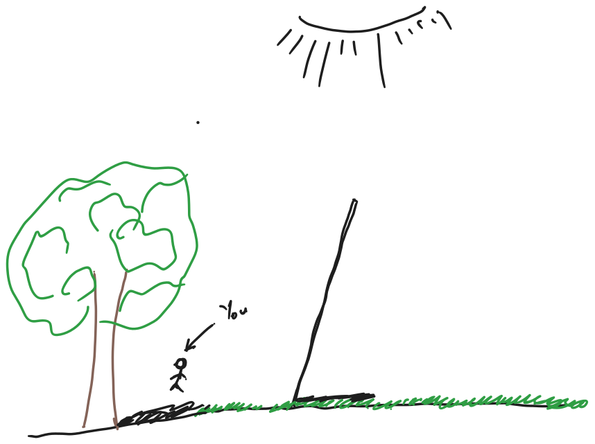
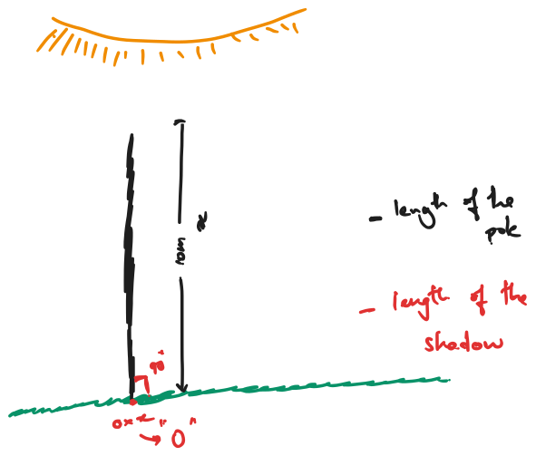
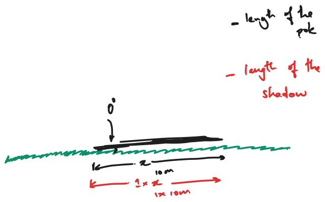
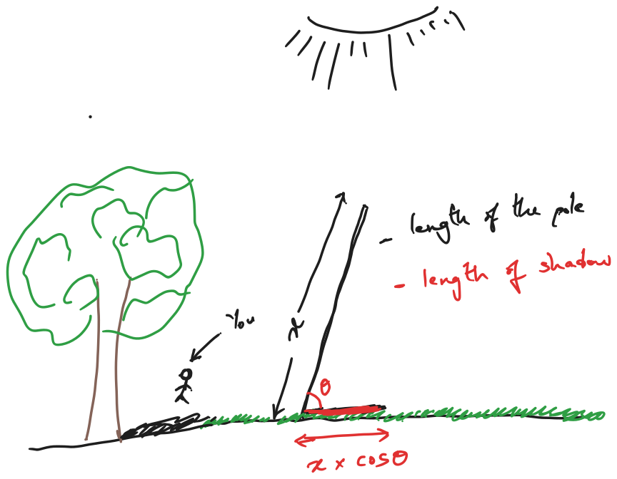
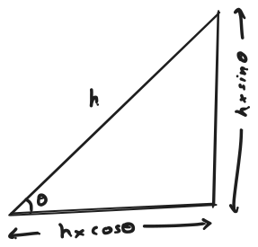

Let's assume you're walking on a sunny day and for some reason you encounter a pole that's falling gradually to the ground. A pole planted in loose soil takes upto hours to fall to the ground as the foundation weakens, however, for the dearth of time, let's say you chose to sit down and watch it fall.

A sudden intuition strikes you. A plethora of concepts strike your mind. From your childhood, you were learning the concepts of mathematics like Triangles and Trigonometry without ever realising their use in real life.

Let's assume the pole is fully erect and hasn't even started falling to the ground.

Since the sun is directly up above our head and you observe that the pole doesn't form any shadow at all!

So let's assume the length of the pole is **10 meters** but the length of the shadow is **0** because there's no shadow at all. This is when the pole is perpendicular to the ground i.e forming **90o** to the ground.

Gradually, the pole has fully fallen to the ground the length of the shadow once the the pole is fully on the ground is the length of the pole itself which is **10 meters**.

Now we can intuitively understand that the length of the pole fully lying on the floor forms a shadow which is the length of itself when sun is directly up above the head. 
Which means when the angle between the floor and pole is **0o** and the length of the shadow is equal to **10 meters**.

Let's rewind a little bit into the past when the pole is still falling while it's making an angle.

You suddenly understand that length of shadow is `0` when pole is perpendicular to the ground and length is exactly as same as the pole when the pole is fully parallel to the ground.

In trigonometry, we know that the function which has value of `1` when the angle is **zero degrees** and value of `0` when the angle is **90 degrees** is `cosine`.

So intuitively we can say

$\text{length of shadow} = \text{length of pole} \times \cos(\theta)$

Now let's come to the triangles and all the high school stuff!

Even though all the Math we have discussed is a derivative of the Pythagoras theorem, this intuitive way of looking at Mathematics helps us understand complex math problems from the point of view of simple real world problems and how maths helps us solve them.

That's why it's said **Math is the language of the Sciences**.
