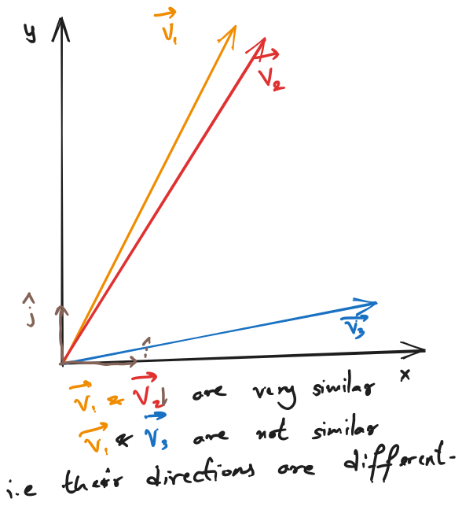
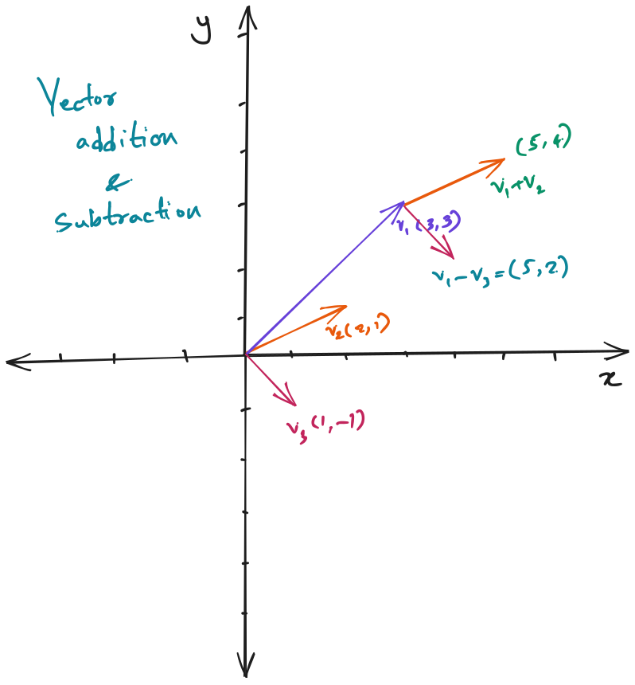
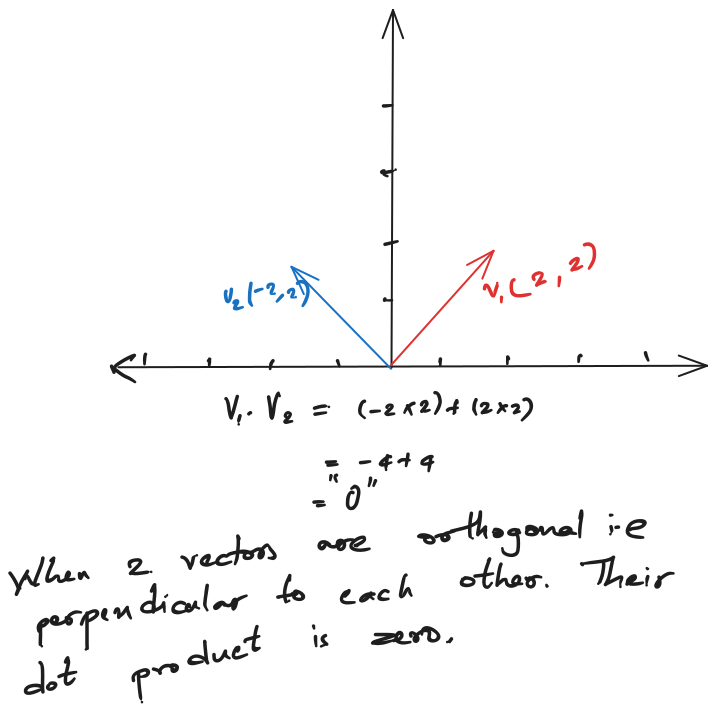
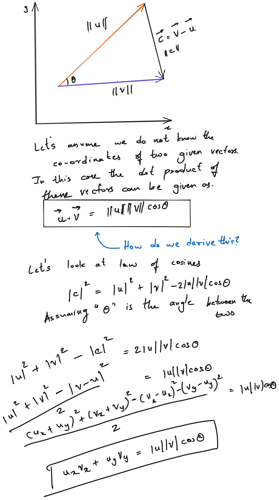

A vector is something that has magnitude and direction. This is our textbook definition. But to understand why the direction matters, we need to understand what the direction talks about. So let’s talk about something fundamental to vectors.

## Basis
Basis vector is the reference from which all vectors are looked at. In terms of Algebra, it can be compared to the standard x and y axes, etc. that stem from the origin, but the basis vectors are usually unit vectors of magnitude 1 pointing in the direction of the axes themselves.

The below vectors v1, v2, and v3 are referenced with respect to the basis vectors.

Vectors also behave like numbers. We can add and subtract them. While vector multiplication is a different subject.

There is a product of two vectors called dot product. It is obtained by multiplying the same direction magnitudes and then summing all of them up. See below visualisation for a dot product.

## Visualising how the Dot product is derived 
We need to understand how the co-ordinate vectors (ux, uy) and (vx,vy) dot product would equal the magnitude multiplication formula assuming the angle between them is "theta".

$$\vec{u} \cdot \vec{v} = |\vec{u}||\vec{v}|\cos(\theta)$$

